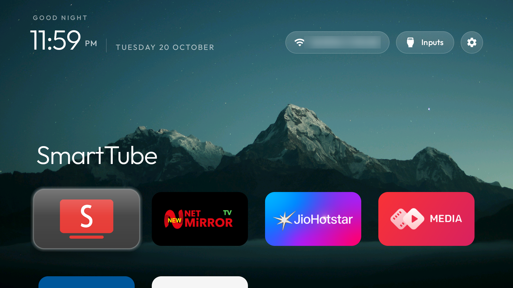
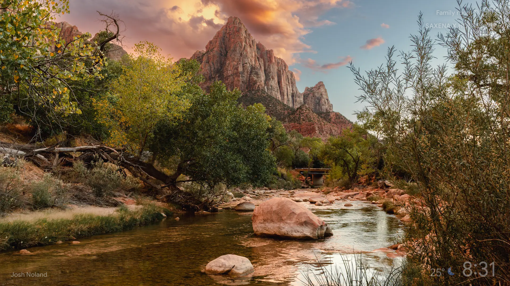
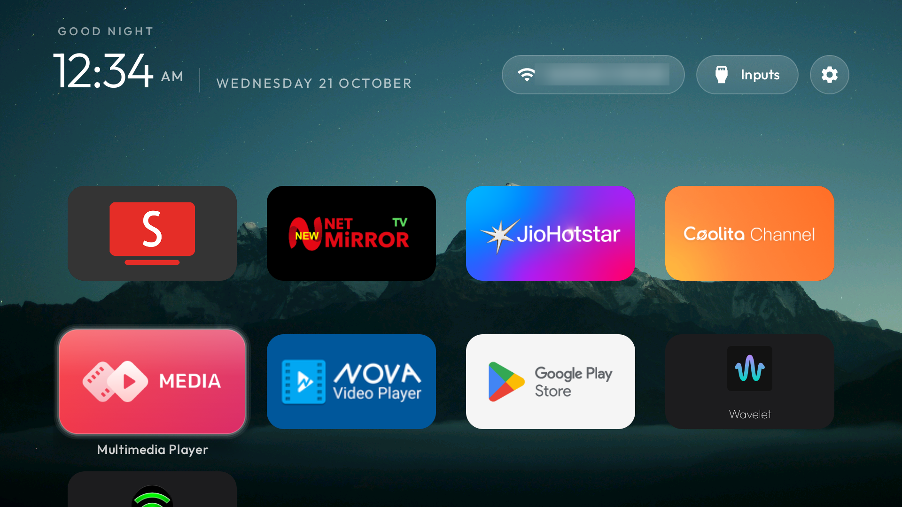

# 📺 CleanYourTV — Apple tvOS Edition

<p align="center">
  
</p>

<p align="center">
  <b>Transform any Android TV or Google TV into a lightning-fast, ad-free Apple tvOS experience.</b><br>
  <i>No root required · Zero cables · Safe user-space debloat · Full one-line rollback</i>
</p>

<p align="center">
  <a href="LICENSE"></a>
  <a href="../../releases"></a>
  <a href="https://github.com/Gathin23/cleanyourtv"></a>
  
  
</p>

---

## 📸 Visual Showcase

| Stock Google TV (Before) | CleanYourTV — Apple tvOS Edition (After) |
|:---:|:---:|
|  |  |
| *Cluttered with sponsored banners, autoplay trailers, and OEM bloatware* | *Clean, floating dock, true 4K UHD wallpaper, zero ads, 56 MB RAM* |

<p align="center">
  
  <br>
  <i>Clean app grid featuring dual-category discovery (Leanback + Sideloaded apps) with system utilities neatly tucked away.</i>
</p>

---

## ✨ Key Enhancements in This Edition

This fork builds directly upon [Gathin23/cleanyourtv](https://github.com/Gathin23/cleanyourtv) and introduces substantial visual, behavioral, and architectural upgrades:

### 1. 🍎 Apple tvOS Focus Engine & Specular Glass UI
- **Physics-Based Card Scaling:** Focused app tiles dynamically elevate and scale to `1.10x` with an elevation jump to `14dp` using an authentic `220ms` decelerate ease-out curve (`DecelerateInterpolator(1.8f)`).
- **Apple tvOS Continuous Squircles:** Tile corners and glass panels are rendered with smooth `18dp` squircle curvature across all views.
- **2-Stop Translucent Glass:** Multi-layered specular sheen (`0x24FFFFFF` → `0x0CFFFFFF`) with a `1dp` bright specular rim light (`0x40FFFFFF`) reflecting light across tile edges.

### 2. 🪟 Floating Transparent Dock
- Removed the heavy, dark rectangular dock container bounding box from `DockDecoration.java`.
- Dock app cards now float directly over your 4K backdrop, perfectly matching the modern Apple tvOS aesthetic.

### 3. 🖼️ Static 4K UHD Wallpaper Engine
- **Eliminated Color-Shifting (`AmbientGlow`):** Disabled the GPU-intensive palette extractor that previously flashed pink/blue background tints when moving focus across different app banners.
- **Expanded Bitmap Budget:** Upgraded `WallpaperSize.java` pixel limit to 25 Megapixels, enabling true `3840×2160` (4K UHD) backdrops without memory strain.

### 4. 🚀 Automated 4K Wallpaper Pipeline (`push_wallpaper_from_downloads.ps1`)
- Run a single command to detect the latest image in your PC's `Downloads` folder, automatically center-crop it to 16:9, resize it using high-quality bicubic resampling to `3840×2160` at 95% JPEG quality, and push it directly to your TV over ADB.

### 5. 🔍 Dual-Category App Discovery & Auto-Refresh
- Queries **both** `CATEGORY_LEANBACK_LAUNCHER` (official Android TV apps) and `CATEGORY_LAUNCHER` (sideloaded / standard Android apps), merging and deduplicating them in real-time.
- **Auto-Refresh BroadcastReceiver:** Any app downloaded from Google Play Store or sideloaded immediately appears on the home screen grid without requiring a launcher restart or rebuild.
- **Utility Filtering:** Redundant background system services (such as Settings, Live TV input handlers, and Wi-Fi Display sink) run silently in the background while being cleanly filtered from the home screen grid.

### 6. 🧭 Ergonomic Header Bar Reordering
- Header controls are ergonomically reordered left-to-right:
  `[Wi-Fi Pill (Full SSID)]` $\rightarrow$ `[Inputs / HDMI Selector]` $\rightarrow$ `[Settings (Icon-Only)]`
- Wi-Fi SSID text truncation was eliminated with an expanded width constraint, displaying your full wireless network name.

### 7. 🛡️ Production Debloat Profile (`my-debloat.txt`)
- Field-tested on **Motorola EnvisionX 55" 4K QLED / Skyworth SW6H (Android 11)**.
- Safely freezes 27+ OEM background bloatware services (demo apps, factory test menus, sync adapters, and recommendation engines) without touching Play Store, Voice Search, Chromecast, or HDMI switching.
- **100% reversible** at any time using `tools/restore.ps1`.

---

## ⚡ Quick Start Guide

### Prerequisites
1. **Android TV / Google TV** on the same local Wi-Fi or Ethernet network as your PC.
2. **Developer Options & Network Debugging** enabled on the TV:
   - Go to `Settings` $\rightarrow$ `Device Preferences` $\rightarrow$ `About` $\rightarrow$ click `Build` **7 times**.
   - Go to `Settings` $\rightarrow$ `Developer Options` $\rightarrow$ toggle **USB debugging** / **Network debugging** to **ON**.
3. Note your TV's IP address (e.g. `192.168.1.50`) from `Settings` $\rightarrow$ `Network & Internet`.

---

### Step 1: Set Your TV Host Variable
In PowerShell on your Windows PC:
```powershell
$env:TV_HOST = "192.168.1.50"   # Replace with your TV's IP
```

---

### Step 2: Safe One-Click Debloat
Disable background bloatware, telemetry, and OEM demo services safely:
```powershell
# Setup python ADB environment (first time only)
python -m venv tools\venv
.\tools\venv\Scripts\pip install -r tools\requirements.txt

# Apply the safe debloat profile
.\tools\disable.ps1 -TvHost $env:TV_HOST my-debloat.txt
```
> **Need to rollback?** Run `.\tools\restore.ps1 -TvHost $env:TV_HOST my-debloat.txt` to restore all packages immediately.

---

### Step 3: Install CleanYourTV Launcher

#### Option A: Install Pre-Built Release APK (Fastest)
Download `CleanYourTV-tvOS-v1.0.0.apk` from the [Releases](../../releases) tab, then push and install via ADB:
```powershell
$py = ".\tools\venv\Scripts\python.exe"
& $py -I tools\b64push.py CleanYourTV-tvOS-v1.0.0.apk /data/local/tmp/tvhome.apk
& $py -I tools\tv.py "pm install -r /data/local/tmp/tvhome.apk"
& $py -I tools\tv.py "cmd package set-home-activity --user 0 com.gathin.tvhome/.MainActivity"
& $py -I tools\tv.py "am start -n com.gathin.tvhome/.MainActivity"
```

#### Option B: Build & Deploy from Source
```powershell
.\build_deploy.ps1 -TvHost $env:TV_HOST -InputKeyService
```

---

### Step 4: Set Your 4K Wallpaper (Automated)
Drop your favorite 4K wallpaper into your PC's `Downloads` folder, then run:
```powershell
.\push_wallpaper_from_downloads.ps1 -TvHost $env:TV_HOST
```
The script will center-crop the image to 16:9, format it to 3840×2160 UHD, push it to `/sdcard/Android/data/com.gathin.tvhome/files/wallpaper.jpg`, and reload your launcher.

---

## ⚙️ Configuration (`config.xml` & `config.json`)

CleanYourTV can be customized either at compile time via `launcher/app/src/main/res/values/config.xml` or at runtime via `/sdcard/Android/data/com.gathin.tvhome/files/config.json`:

```json
{
  "dock_apps": [
    "org.smarttube.stable",
    "app.netmirror.newtv",
    "in.startv.hotstar",
    "com.amazon.amazonvideo.livingroom"
  ],
  "hidden_apps": [
    "com.android.tv.settings",
    "com.smartdevice.livetv",
    "com.smartdevice.duplebluetooth",
    "com.mediatek.wfd.sink",
    "com.mediatek.androidbox"
  ],
  "columns": 4
}
```

---

## 📊 Performance Benchmarks (Live Verified)

Live audit metrics captured on Skyworth SW-22AE NF / SW6H (Android 11, MediaTek M7332):

| Metric | Stock Google TV | CleanYourTV (Apple tvOS Edition) | Improvement |
|---|:---:|:---:|:---:|
| **Launcher RAM (PSS)** | ~150 MB+ | **56.6 MB** | **↓ 62% lighter** |
| **GPU Compositing RAM** | Heavy multi-layer | **21.8 MB** (hardware accelerated) | **Zero UI stutter** |
| **Active System Packages** | 132 | **100** | **32 fewer bloat services** |
| **Available Free RAM** | ~350 MB | **718 MB (~40% total RAM free)** | **+368 MB headroom** |
| **Ad Load Time** | 3–5s initial cold fetch | **Instant (0 ms, zero ads)** | **Immediate response** |

---

## 🤝 Credits & Acknowledgments

- **Original Foundation:** Built upon the open-source [CleanYourTV](https://github.com/Gathin23/cleanyourtv) project by [Gathin23](https://github.com/Gathin23).
- **License:** Licensed under the [MIT License](LICENSE).
